# CohortDesk

**A multi-tenant education-management platform for independent training centres, built with Django.**

[](https://github.com/Ama-yes/CohortDesk/actions/workflows/ci.yml?query=branch%3Amain)

CohortDesk is a server-rendered Django application that runs several
independent training organizations inside one deployment. It covers the
operational core of a small centre: admissions, students, academic structure,
scheduling, attendance, fee collection and raw assessment results — with
tenant isolation and role-based authorization enforced on the server.

The project is a working, test-backed implementation of the first four
milestones in its requirements specification. It is **not** a finished
commercial product: certificates, PDF reporting, bulk imports, notifications,
final grading policy and full localization remain deliberately deferred (see
[Known limitations](#15-known-limitations-and-deferred-functionality)).

---

## 1. Problem

Small training centres usually run on spreadsheets and chat threads. Student
records, class schedules, attendance and fee balances live in separate files
that drift apart. A purpose-built system needs three things that spreadsheets
cannot provide:

- **One source of truth per organization** — students, cohorts, sessions,
  attendance, fees and results connected by real relationships.
- **Access that matches responsibility** — a receptionist, an instructor and a
  finance officer should not see the same data.
- **Isolation between organizations** — one installation hosting several
  centres must never leak one centre's records into another.

CohortDesk targets small independent language and vocational training centres
that employ a handful of staff and need an affordable, self-hosted system.

---

## 2. Main capabilities

All items below are implemented and covered by tests.

| Area | What works |
| --- | --- |
| Organizations | Tenant records, membership, per-centre settings, preferred locale, currency, scheduling-conflict policy |
| Authentication | Sign-in, sign-out, choose-a-centre, working-centre session state |
| Roles | Owner, Administrator, Receptionist, Academic Coordinator, Instructor, Finance Officer; 51 permission codes |
| Students | Student records, profile pages, create/edit, archive rules, centre-scoped student numbers |
| Admissions | Applications, status transitions, record/accept/convert-to-enrollment |
| Programs | Program grouping for courses, create/edit |
| Academic periods | Centre academic years with containment rules |
| Courses | Course catalogue, ordered modules |
| Cohorts | Cohort lifecycle, capacity policy, default room, instructor assignment |
| Enrollments | Enrollment statuses, capacity enforcement, archival discipline |
| Staff | Staff records, employment status, account linking, course and cohort instructor links |
| Rooms | Room records and archiving |
| Scheduling | Recurring schedule patterns, concrete sessions, half-open conflict detection, DST handling |
| Attendance | Per-session registers, four statuses, corrections, immutable audit history |
| Finance | Fee obligations, installment plans, payments, exact allocations, per-centre receipt numbers, adjustments/refunds, expenses, derived summaries, CSV receipts |
| Grading | Assessments, one raw score per assessment/enrollment, grade-change audit trail, cohort result sheets, CSV export |
| Reporting | Cohort capacity, attendance registers, enrollment lists, finance summaries, grading reports, CSV export |
| Audit | Organization settings, membership changes, attendance corrections, payments/reversals, grade changes, assessments |

Deliberately **not** implemented: payment gateways, SaaS billing, automated
email/SMS, PDF generation, certificates, bulk imports, notification centre,
final grades, pass/fail decisions, resits and production deployment.

---

## 3. Screenshots

All screenshots are genuine captures of the running application with synthetic
demo data (`Atlas Language Center`, students `Amina Atlas` and `Yacine Atlas`).
No real personal data appears. All nine were re-captured on 2026-11-22 after the
UI pass, so they show the current design system.

### Centre dashboard

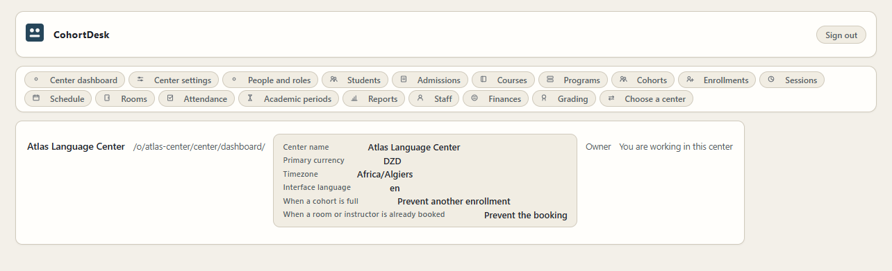

### Students

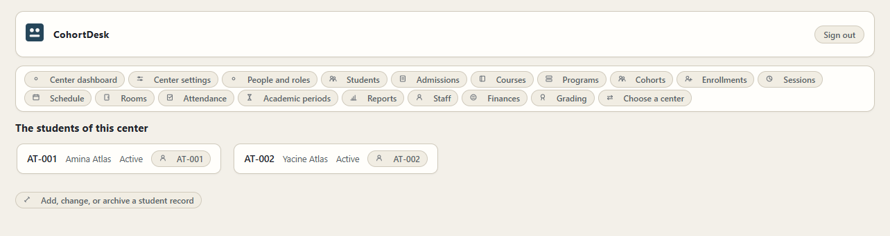

### Cohorts and enrollment

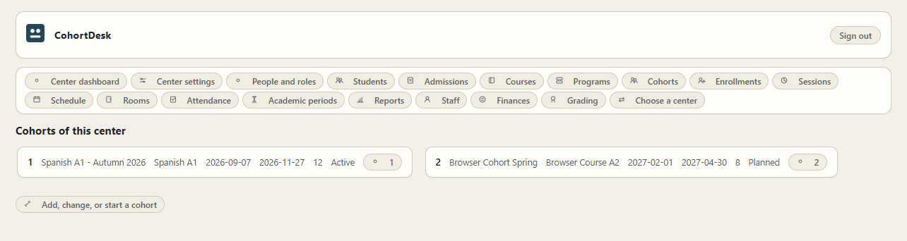

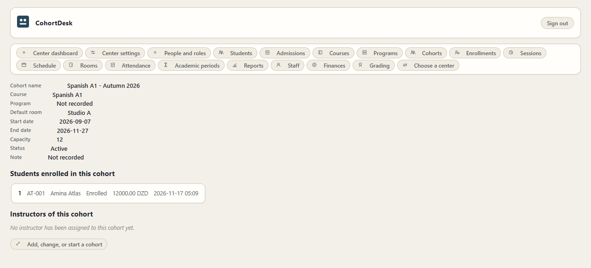

### Attendance register

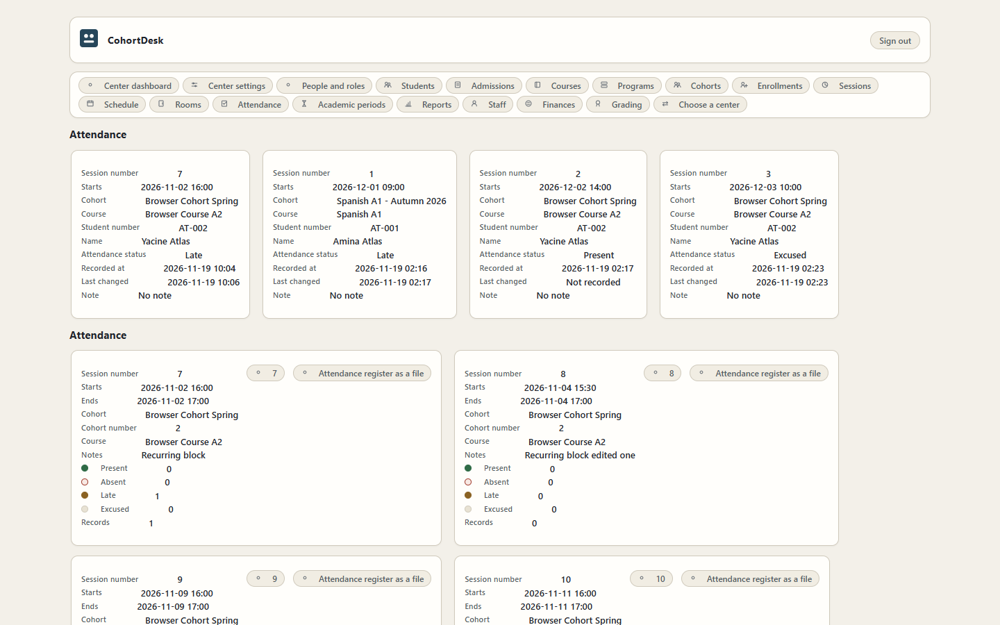

### Finance

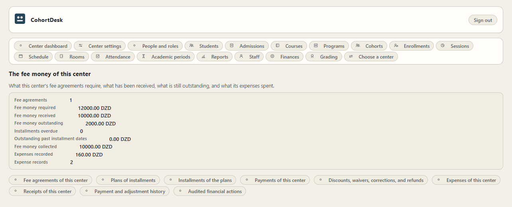

### Academic period report

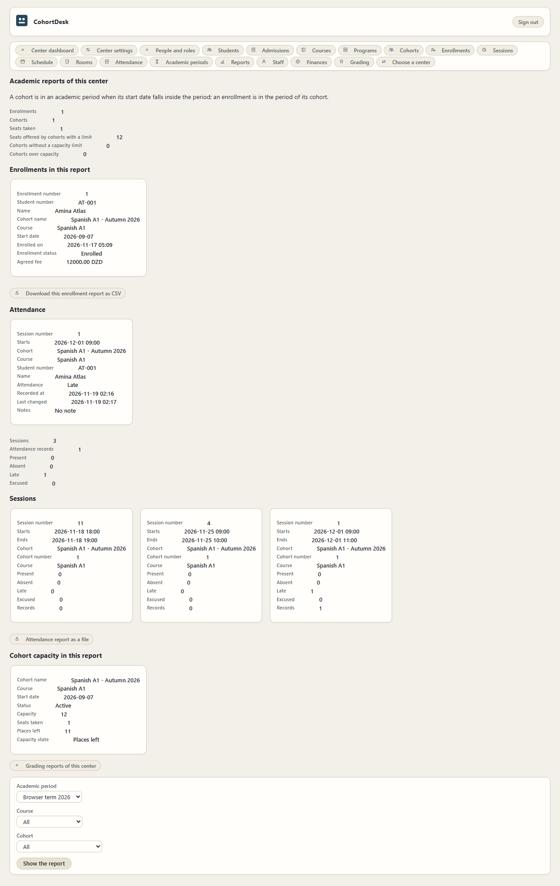

### Grading

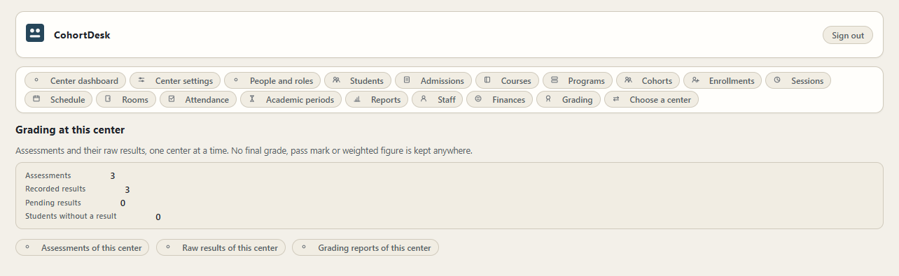

### Responsive layout at 390px

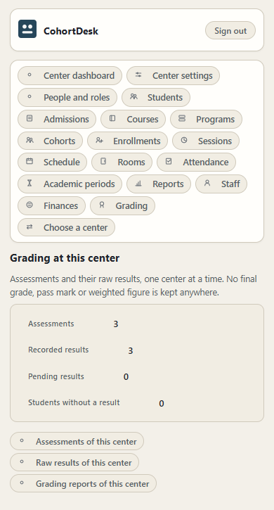

The interface is server-rendered semantic HTML with a single hand-written
stylesheet (`static/css/ui.css`). As of the 2026-11 UI pass that stylesheet is a
small design system: named tokens for surfaces and ink, a 4px spacing rhythm,
one family of 16px line icons drawn inline in the stylesheet, chip and panel
components shared by every page, and direction-relative layout throughout so
Arabic and other RTL locales mirror. It is still deliberately not a
framework — the SRS names Tailwind CSS, and that heavier milestone stays
deferred. The screenshots show the real current UI rather than a mockup.

---

## 4. Technology stack

Verified from `requirements.txt`, `config/settings.py` and the environment.

| Layer | Choice |
| --- | --- |
| Language | Python 3.14 |
| Framework | Django 6.1.3 |
| Database (development and tests) | SQLite |
| Database (declared, not exercised) | PostgreSQL via `psycopg` 3.3.9 |
| Front end | Django templates, semantic HTML, one hand-written direction-relative CSS design system |
| Authentication | Django's auth system with a custom `CohortUser` model |
| Tests | Django's test runner (`manage.py test`) |

Only two runtime dependencies are pinned. There is no JavaScript framework, no
build step, no Node runtime requirement and no external service dependency.

---

## 5. Architecture overview

CohortDesk is a **modular monolith**. Each domain is a Django app with its own
models, service layer, URLs and tests; the shared infrastructure lives in
`apps/pages.py`, `config/urls.py` and `apps/i18n.py`.

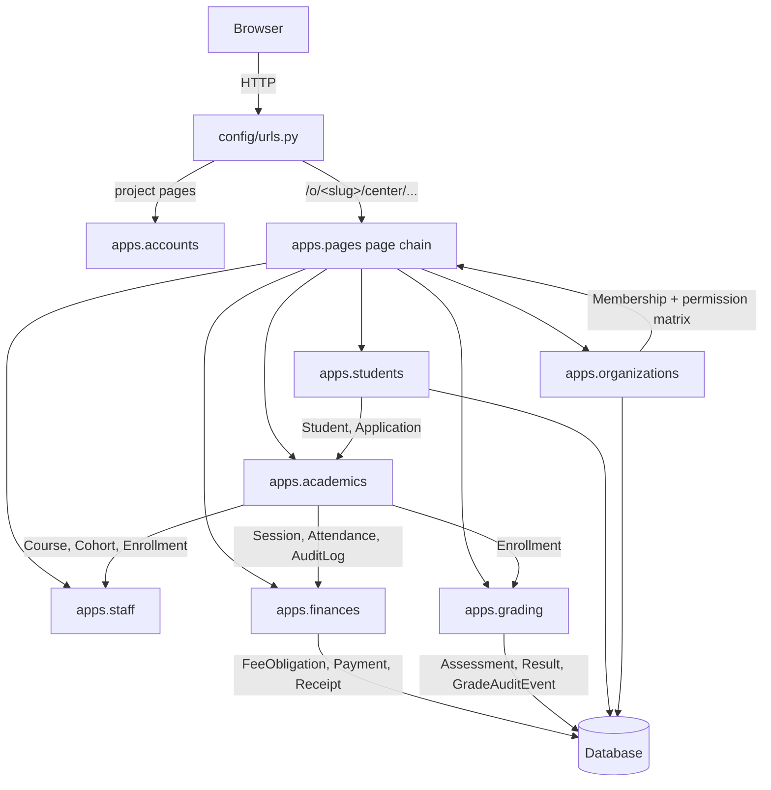

**Request pipeline.** Every tenant screen goes through one function,
`apps.pages.page()`, which:

1. resolves the organization from the URL slug and the caller's membership;
2. answers an unknown slug, missing membership and suspended membership with
   the *same* 404 page;
3. checks the permission code registered for that page;
4. renders a template with the centre's locale glossary and permission-filtered
   navigation.

**Layering.** Views parse input and render pages; **services** own business
rules and state transitions; **models** enforce structural invariants
(constraints, `clean()` methods); **permissions** is the single authorization
table. Audit events are written by services beside the change they describe.

See [`docs/ARCHITECTURE.md`](docs/ARCHITECTURE.md) for the full model map,
request flow and design rules.

---

## 6. Multi-tenant isolation and permissions

Isolation is enforced server-side on every tenant operation, not by hiding
links.

- **Address space.** Tenant pages live under `/o/<slug>/center/...`. Project
  and account pages live at `/` and `/accounts/...`.
- **Uniform silence.** An unknown slug, a non-member and a suspended member all
  receive the same 404 problem page, so status codes never reveal whether
  another centre exists.
- **No cross-tenant lookups.** Foreign primary keys resolve to the caller's own
  centre 404, never to another centre's record.
- **Authorization before rendering.** Each page declares a permission code;
  denial is that centre's own 403 page, not a 404 and not a hidden control.
- **Navigation is presentation.** The shell shows only permitted links, but the
  address-level checks are independent and separately tested.
- **Instructor narrowing.** Instructors are scoped to the cohorts assigned to
  their staff record for attendance, grading and student profiles — enforced in
  the service and view layer, not the rendered list. A profile outside that scope
  answers the centre's own 404; enrollment status (active, completed, withdrawn,
  cancelled) never removes that historical access.

### Role matrix (summary)

| Permission family | Owner | Administrator | Receptionist | Academic Coordinator | Instructor | Finance Officer |
| --- | :-: | :-: | :-: | :-: | :-: | :-: |
| Organization settings | ✓ | ✓ | | | | |
| Members and roles | ✓ | ✓ | | | | |
| Students view | ✓ | ✓ | ✓ | ✓ | ✓ (scoped) | |
| Students manage | ✓ | ✓ | ✓ | | | |
| Admissions | ✓ | ✓ | ✓ | | | |
| Courses / programs | ✓ | ✓ | ✓ (view) | ✓ | ✓ (view) | |
| Cohorts / enrollments | ✓ | ✓ | ✓ | ✓ | | |
| Sessions / rooms | ✓ | ✓ | view | ✓ | | |
| Attendance | ✓ | ✓ | | ✓ | ✓ (scoped) | |
| Staff records | ✓ | ✓ | | ✓ (view) | self | |
| Finance | ✓ | ✓ | | | | ✓ |
| Grading | ✓ | ✓ | | ✓ | ✓ (scoped) | |
| Reports | ✓ | ✓ | ✓ | ✓ | | |

The authoritative table is `apps/organizations/permissions.py`; the matrix
above is a readable summary, not a second source of truth.

---

## 7. Data relationships and workflows

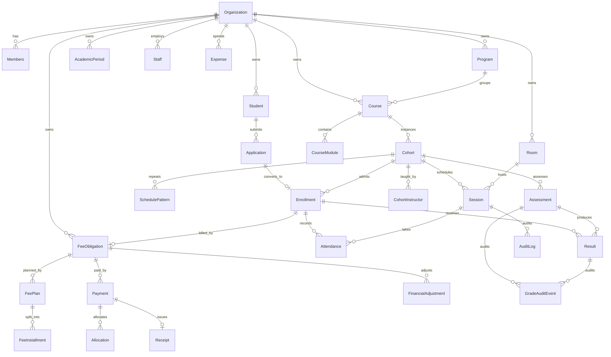

### Key workflows

1. **Admission.** Application recorded → accepted → converted to an enrollment
   in a cohort. Duplicate and lifecycle rules live in `apps.students.services`.
2. **Enrollment.** Capacity, status transitions and archival are enforced in
   `apps.academics.services`; a full cohort follows the centre's policy.
3. **Scheduling.** A recurring `SchedulePattern` generates concrete `Session`
   rows. Conflicts are detected with half-open interval comparison scoped to
   one organization; spring-forward local times are refused rather than
   silently shifted.
4. **Attendance.** A session register records one of four statuses per enrolled
   student. Later corrections create audit entries and never rewrite history
   invisibly.
5. **Fees.** An obligation is split into exact installments; payments allocate
   against installments; reversals take back cumulatively. Receipt numbers are
   sequential per centre. A submission token prevents double-posting.
6. **Grading.** An assessment belongs to one cohort. A result stores one raw
   score per assessment/enrollment, nullable so "not recorded" never becomes
   zero. Every create and update writes a `GradeAuditEvent` with previous and
   new scores, reason and actor.

---

## 8. Project structure

```
CohortDesk/
├── config/                 settings, root URLs, WSGI/ASGI, health view
├── apps/
│   ├── accounts/           CohortUser, sign-in/out, working-centre session
│   ├── organizations/      Organization, Members, roles, permissions, settings
│   ├── students/           Student, Application, statuses, services, views
│   ├── academics/          Program, Course, Cohort, Room, Session, Attendance
│   ├── staff/              Staff, course/cohort instructor links
│   ├── finances/           Obligations, plans, payments, receipts, expenses
│   ├── grading/            Assessments, results, grade audit events
│   ├── pages.py            the single tenant page-rendering chain
│   └── i18n.py             the UI string glossary (en/fr/ar)
├── templates/              base shell, centre shell, per-page templates
├── static/                 ui.css and the logo
├── docs/                   SRS, architecture, screenshots
├── .github/workflows/      CI
├── manage.py
└── requirements.txt
```

Each app follows the same internal shape: `models.py`, `services.py`,
`views.py`, `urls` registered centrally, `statuses.py` where a vocabulary
exists, and `test_model_rules.py` / `test_access.py` splits.

---

## 9. Local installation

Requires Python 3.12–3.15 (the project is developed on 3.14).

```bash
git clone https://github.com/Ama-yes/CohortDesk.git
cd CohortDesk
python -m venv .venv
```

Activate the environment:

```bash
# Windows PowerShell
.\.venv\Scripts\Activate.ps1
# macOS / Linux
source .venv/bin/activate
```

Install dependencies and create the local environment file:

```bash
pip install -r requirements.txt
cp .env.example .env      # then edit .env
```

Set at least:

```
COHORTDESK_SECRET_KEY=<a long random string>
COHORTDESK_ENVIRONMENT=development
```

The application refuses to start without `COHORTDESK_SECRET_KEY`. Generate a
key with:

```bash
python -c "import secrets; print(secrets.token_urlsafe(50))"
```

`.env` is gitignored. `.env.example` contains placeholders only.

---

## 10. Migrations and database initialisation

Development and tests use SQLite by default (`COHORTDESK_DB_ENGINE=sqlite`).
The development database is created at `.local/dev.sqlite3` and is gitignored.

```bash
python manage.py migrate
python manage.py createsuperuser   # optional, for /admin/
```

Check that no model changes are missing a migration:

```bash
python manage.py makemigrations --check --dry-run
```

PostgreSQL is configurable (`COHORTDESK_DB_ENGINE=postgres` plus
`COHORTDESK_DB_*`), but it has **not** been verified against this codebase;
only SQLite is exercised by the test suite.

---

## 11. Tests and verified baseline

Run the suite:

```bash
python manage.py test
```

**Verified local baseline:** `Ran 789 tests in 2520.559s` → `OK (skipped=1)`.

The single skip is a PostgreSQL-only race check in
`apps/finances/test_model_rules.py`; on SQLite `select_for_update` isolates the
whole transaction, so no row-locking race can be reproduced. No PostgreSQL
concurrency claim is made.

Also verified:

```bash
python manage.py check          # 1 known warning: finances.Receipt.payment fields.W342
python manage.py makemigrations --check --dry-run   # no changes
git diff --check                # clean
```

Test modules (service/model rules and URL-layer access tests):

| Module | Focus |
| --- | --- |
| `apps/organizations/tests.py`, `test_access.py` | membership, tenant isolation, 403/404, 405 |
| `apps/accounts/test_access.py` | sign-in, choose-a-centre, form contracts |
| `apps/students/tests.py`, `test_access.py` | admissions, student rules and pages |
| `apps/academics/tests.py`, `test_access.py` | courses, cohorts, enrollments |
| `apps/academics/test_scheduling.py`, `test_scheduling_access.py` | patterns, conflicts, DST, schedule pages |
| `apps/staff/tests.py`, `test_access.py` | staff and instructor assignment |
| `apps/finances/tests.py`, `test_model_rules.py`, `test_access.py` | money rules, allocations, reversals, pages, CSV |
| `apps/grading/test_model_rules.py`, `test_access.py` | assessments, results, audit trail, scoping, CSVs |

The suite is intentionally slow and thorough: it drives real HTTP requests
through the URL layer to prove authorization and isolation behaviour, not just
service units.

---

## 12. Implemented features and roadmap

### Implemented (Milestones 0–4, plus reporting foundation)

- Tenant and access foundation: organizations, membership, custom user,
  roles, permission matrix, tenant-isolation tests.
- People and academic structure: students, admissions, staff, academic periods,
  programs, courses, modules, cohorts, enrollments.
- Scheduling and attendance: rooms, recurring patterns, sessions, conflict
  detection, instructor views, attendance registers and corrections.
- Finance and assessment: fee obligations, installment plans, payments,
  allocations, receipts, reversals/adjustments, expenses, assessments, raw
  results, grade audit, grading reports.
- Reporting foundation: cohort, attendance, enrollment, finance and grading
  CSV exports gated by the same permissions as their pages.

### Roadmap (from `docs/SRS.md`, not yet implemented)

| Milestone | Remaining work |
| --- | --- |
| 5 — Documents, reporting, imports | Certificates and verification (DOC-001…008), PDF/print reporting (REP-006), broader reports (REP-003), CSV/XLSX imports (IMP-001…005), audit completion (AUD-001…004) |
| 5 — Notifications | In-app action centre for overdue installments and attendance concerns (NOT-001…004) |
| 6 — Product polish | Complete French and Arabic translation, Arabic RTL validation, Tailwind design system, responsive refinement, accessibility review |
| 7 — Production readiness | Deployment hardening, PostgreSQL verification, backups, monitoring, pilot |

---

## 13. Known limitations

These are deliberate, documented boundaries — not hidden gaps.

- **No production deployment.** The project runs locally only; nothing is
  deployed.
- **SQLite only in practice.** PostgreSQL is declared and configurable but
  untested; the row-locking test is skipped.
- **No final grading policy.** There are no scales, bands, pass marks, pass/fail
  outcomes, final grades, rounding rules, resits or publication controls. A
  score is a nullable raw value with no derived meaning.
- **No certificates or PDFs.** DOC-001…008 and REP-006 are not implemented.
  Certificate eligibility would depend on grading semantics that do not exist.
- **No imports.** IMP-001…005 are not implemented; there is no CSV/XLSX
  student import, preview or rollback.
- **No notifications.** NOT-001…004 are not implemented; there is no in-app
  action centre, threshold configuration or template library.
- **Localization is incomplete.** `apps/i18n.py` has 897 English keys, 75 French
  and 135 Arabic entries. Missing keys fall back to English. No French or
  Arabic translation has been fabricated or machine-approved.
- **Visual design is hand-built, not frameworked.** The 2026-11 UI pass made
  `static/css/ui.css` a token-driven design system (shared chips, panels, icons,
  spacing rhythm), but it is still one hand-written stylesheet; the Tailwind CSS
  design system named in the SRS and its full polish milestone remain deferred.
- **CSV, not XLSX.** Exports are CSV. No spreadsheet library is a dependency.
- **No accessibility audit.** Semantic markup is used, but no formal WCAG
  review has been performed.

---

## 14. Security considerations

- **Secrets.** `SECRET_KEY` is read from the environment; the application
  raises at startup if it is absent. No secret is committed. `.env` is
  gitignored and `.env.example` contains placeholders only.
- **Tenant isolation.** Every tenant read and write is scoped to the caller's
  organization server-side. Cross-tenant identifiers resolve to a same-centre
  404, never to foreign data. Membership writes are centre-scoped: an account
  already attached to another centre cannot be invited into this one.
- **Authorization.** 51 permission codes are declared centrally. Unknown codes
  fail closed. Denial is a 403 page, not a redirect or a hidden control.
- **CSRF.** All state-changing forms carry ``; the middleware
  is enabled and tested.
- **Money handling.** Amounts are `Decimal`, never floats. Payments allocate
  exactly; reversals take back cumulatively; a submission token prevents
  double-posting. Status moves (open→paid, payment→reversed) are revalidated
  from the locked rows, and submission tokens are length-bounded before storage.
- **Audit.** Attendance corrections, payment creation/reversal, fee
  adjustments, grade changes, assessments and membership changes write audit
  records that ordinary users cannot edit.
- **CSV safety.** Every export writes cells through one shared writer that
  neutralises spreadsheet formula injection: text starting with `=`, `+`, `-`,
  `@`, a tab or a line break is written as spreadsheet text; ordinary decimal
  numbers, including negative amounts, are left untouched.

### Development-only caveats

- `DEBUG` is true when `COHORTDESK_ENVIRONMENT=development`.
- `manage.py check --deploy` reports development-security warnings; the project
  has not been hardened for a public host.
- The browser-verification accounts (`*-browser-*`) exist only in a local
  development database and are not part of the repository.
- No real credentials, private keys or production configuration appear in the
  tracked tree.

---

## 15. Repository status and license

- This repository is a **curated public snapshot** of the development work:
  curated commits only. The private development history is not published, and
  this is not a tagged release.
- **No license file is present.** The code is therefore unlicensed: it remains
  the copyright holder's work and may not be reused without permission. The
  owner must choose a license before reuse rights can be granted.

---

## 16. Testing and quality workflow

Every change is expected to:

1. pass its focused test module;
2. pass `python manage.py check` and `makemigrations --check`;
3. pass the full suite before it reaches the stable branch;
4. pass `git diff --check`;
5. be verified in a browser when it changes a page.

CI runs system checks, migration consistency and the test suite on SQLite —
see `.github/workflows/ci.yml`. The full local suite takes roughly 42 minutes,
so CI is configured as an honest verification job rather than a fast gate.

Full-suite runs in this repository are tracked in its own Actions history;
the run started by each curated commit is recorded there. The badge above
points at `main`.

---

## 17. Contributing

This is a personal portfolio project and is not currently accepting external
contributions.

If you are reading the code, the most useful entry points are:

- `apps/organizations/permissions.py` — the whole authorization model in one
  table;
- `apps/pages.py` — how every tenant page is resolved and rendered;
- `docs/SRS.md` — the requirements the implementation is measured against.

Coding conventions: services own rules, views own HTTP, models own invariants,
permissions own authorization, templates own no product copy (all copy lives in
`apps/i18n.py`).
