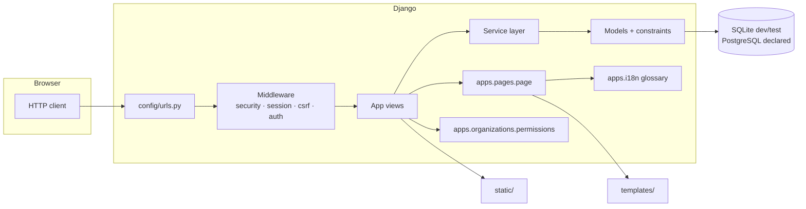
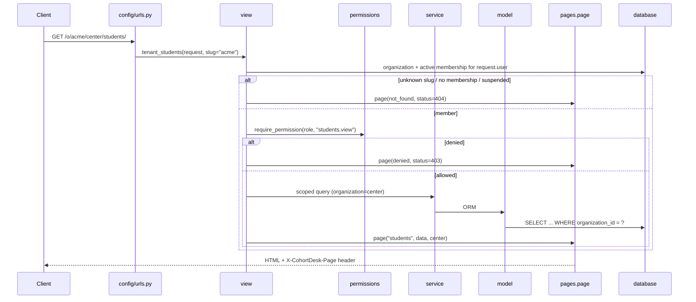
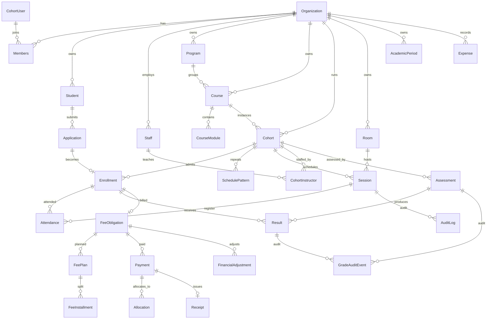

# CohortDesk architecture

This document describes how the implementation is put together. It is
descriptive: the requirements live in [`docs/SRS.md`](SRS.md).

## 1. Shape

CohortDesk is a **Django modular monolith**. A single process serves every
organization; isolation is a property of the data access path, not of separate
deployments.



There are seven apps (`organizations`, `accounts`, `students`, `academics`,
`staff`, `finances`, `grading`) plus `config` and `apps/pages.py`.

## 2. Layering rules

| Layer | Owns | Must not |
| --- | --- | --- |
| `config/urls.py` | the URL address space | contain business rules |
| `apps/<app>/views.py` | parsing input, choosing a page, HTTP status | decide business rules |
| `apps/<app>/services.py` | state transitions, cross-record rules, audit writes | render HTML |
| `apps/<app>/models.py` | structural invariants, constraints, `clean()` | perform multi-record workflows |
| `apps/organizations/permissions.py` | the authorization table | be bypassed by templates |
| `apps/pages.py` | one render path for every page | contain product copy |
| `apps/i18n.py` | all interface copy | be edited per-template |

The practical consequence: a rule that spans records (capacity, allocations,
attendance correction, instructor scoping) is implemented once in a service and
called from the view. A rule about one record (score bounds, unique
constraints) lives in the model and is enforced by the database where possible.

## 3. URL space

```
/                                  project landing
/healthz/                          health check (not tenant-bound)
/accounts/...                      sign-in, sign-out, choose-a-centre
/o/<slug>/center/...               every tenant page
/admin/                            development reference only
```

Tenant URLs are declared centrally in `config/urls.py` and each one names a
view from an app. Literal segments are ordered before numeric catch-alls, and
each `.csv` route before its HTML sibling. Every tenant page is registered in
`apps/pages.py` as a `CENTER_PAGES` kind, and every navigation entry has a
`NAV_LINKS` permission code (or `None` for any active member).

## 4. Request flow for a tenant page



The `X-CohortDesk-Page` response header records which page answered. It is not
authorization — it exists so tests can prove which branch ran. Every request
re-decides on the server.

### Isolation details

- The organization is resolved from the URL slug; the caller's `Members` row
  must exist and be active.
- Missing slug, missing membership and suspended membership return the **same**
  404 page, so the response never distinguishes "does not exist" from "not
  yours".
- A record identifier from another organization is looked up **within the
  caller's organization**, so it resolves to the caller's own 404 rather than
  foreign data.
- Membership writes are centre-scoped: an account already attached to another
  centre cannot be added to this one; the invite form only offers this centre's
  own people and accounts of no centre.
- CSVs use the same permission check and the same scoped query as their HTML
  siblings, and every export writes cells through one shared writer that
  neutralises spreadsheet formula injection.

## 5. Data model



Every tenant-owned table carries an `organization` foreign key. That key is the
scoping column for every query and the anchor for every uniqueness constraint
that must be per-centre (student numbers, receipt counters, submission tokens).

## 6. Authorization

`apps/organizations/permissions.py` is the single table mapping
`domain.action` codes to roles. There are 51 codes. `roles_allowed_for()` raises
`PermissionNotDefined` for an unknown code, so a missing declaration fails
closed rather than granting access.

Roles: `owner`, `administrator`, `receptionist`, `academic_coordinator`,
`instructor`, `finance_officer`.

Two rules shape the matrix:

1. **Hiding is not authorization.** Templates filter navigation by the same
   codes, but every view checks again. Tests prove both independently.
2. **Instructor scope is server-side.** Attendance, grading and student
   profiles narrow an instructor to cohorts assigned through `CohortInstructor`.
   For student profiles the link is the cohort's enrollment rows: any
   enrollment record in an assigned cohort, whatever its status, keeps that
   learner's profile reachable; every other profile answers the centre's own
   404. The narrowing is applied to the queryset, not to the rendered list.

## 7. Money and grading invariants

These two domains carry the strongest correctness requirements.

### Financial integrity

- Amounts are `Decimal`, never `float`.
- An obligation is split into installments whose sum equals the obligation.
- Payments allocate exactly; over-allocation is rejected against locked
  figures.
- Reversals take money back cumulatively and never below zero.
- Receipt numbers come from a per-centre counter row.
- Posting takes locks in one documented order (obligation, installments,
  payment, counter), so two concurrent postings cannot interleave.
- A `FinanceSubmission` token with a unique centre/person/token constraint and
  exactly one saved outcome prevents double-posting a single submission; tokens
  are length-bounded before storage.
- Status moves (obligation open→paid, payment→reversed) are revalidated from
  the locked rows inside the same block, so a concurrent posting cannot slip a
  stale status through.
- On SQLite, `select_for_update` serializes the whole transaction; the
  PostgreSQL race test is therefore skipped and no concurrency claim is made.

### Raw results

- One `Result` per `Assessment` and `Enrollment`.
- `score` is nullable `Decimal(6,2)`; missing is never stored as zero.
- `maximum` is positive and constrained.
- `weight` is metadata only and is never aggregated.
- No scale, band, pass mark, final grade, rounding rule or resit exists.
- Every assessment creation and result write produces a `GradeAuditEvent`
  with previous and new scores, reason and actor.
- Foreign keys protecting traceability use `PROTECT`, so audit history cannot
  be orphaned by deletion.

## 8. Scheduling rules

- A `SchedulePattern` describes recurrence; concrete `Session` rows are
  generated from it.
- Conflict detection compares half-open intervals scoped to one organization
  and respects the centre's configured policy (prevent or warn).
- Spring-forward local times that do not exist are refused; repeated
  fall-back times use the first fold. Neither is silently normalized.
- Rooms and instructors are resources checked by the same interval logic.

## 9. Audit

Three families exist:

| Family | Model | Written by |
| --- | --- | --- |
| Attendance corrections | `AuditLog` | attendance services |
| Finance events | `FinanceAuditEvent` | finance services |
| Grade events | `GradeAuditEvent` | grading services |

Audit rows record organization, actor, action, affected record, timestamp and
safe before/after metadata. They are append-only in the service layer; no
ordinary page offers edit or delete. Passwords and secrets are never written to
an audit row.

## 10. Rendering and localization

One function renders every page:

```python
page(request, kind, data, center=None, status=200)
```

It chooses a template from `PROJECT_PAGES` or `CENTER_PAGES`, injects the
centre's glossary (`center_ui`), renders CSRF for forms, and sets the
`X-CohortDesk-Page` header. Because all views use it, no page can accidentally
skip the glossary or the header.

All product copy lives in `apps/i18n.py` (`UI_STRINGS`). English is complete
(897 keys). French has 75 entries and Arabic 135; missing keys fall back to
English. No translation is invented.

## 11. Testing strategy

The suite is organized per app into domain modules (`tests.py` and, where
added later, `test_model_rules.py`) for rules, constraints and service
behaviour, and `test_access.py` for URL-level permissions, tenant silence, HTTP
methods and CSV gating. Two additional modules, `test_scheduling.py` and
`test_scheduling_access.py`, cover scheduling. Tests drive real requests
through the URL layer, so authorization is proven at the boundary rather than
at the function that happens to be called.

Verified baseline: **789 tests, OK, 1 skipped** (PostgreSQL-only race check).

## 12. Explicit non-goals in the current code

- No certificates, PDFs or print pipeline.
- No CSV/XLSX import pipeline.
- No notification or action-centre subsystem.
- No final grading policy.
- No payment gateway or billing.
- No background worker, cache or queue.
- No production deployment.
- No complete French or Arabic translation.
